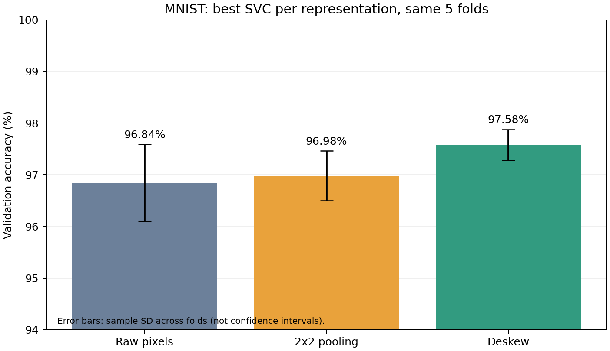
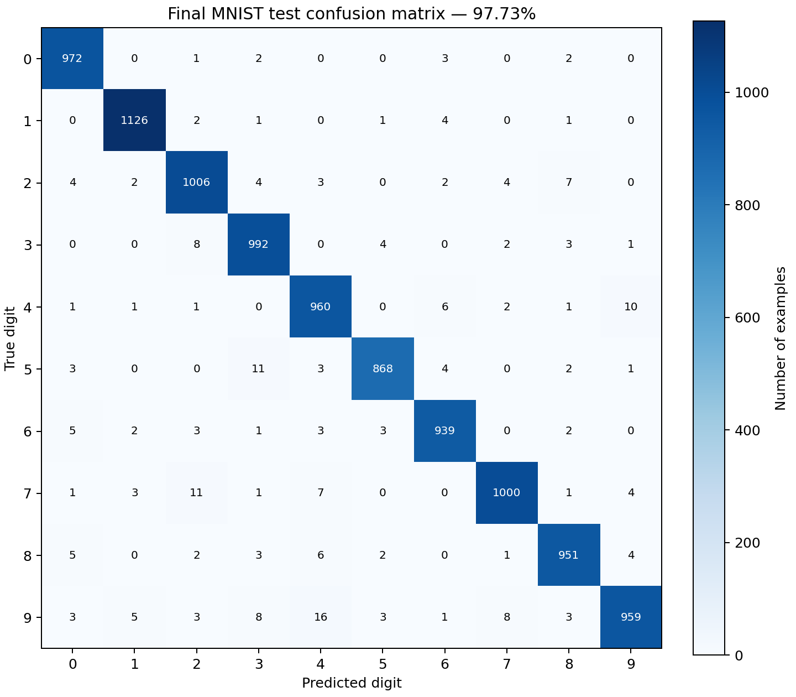

# MNIST Classification: Cross-Validation and Hand-Crafted Features

## Experimental setup

I used the MNIST dataset returned by `fetch_openml("mnist_784", version=1)`. Following the supplied code, the first 10,000 examples were used for training and cross-validation, and the final 10,000 examples were reserved for testing. The intermediate 50,000 examples were not used. Each image originally contained 784 pixel features representing a 28 × 28 image.

I implemented the hyperparameter search manually using five-fold stratified cross-validation with shuffling and random seed `202401391`. Each fold contained 8,000 training examples and 2,000 validation examples. The same fold indices were reused for every candidate and feature representation, allowing direct comparisons. A new estimator was constructed and fitted for every fold; no automatic search classes such as `GridSearchCV` were used.

Pixel intensities were converted to `float32` and divided by the fixed constant 255. This transformation does not estimate statistics from the data and therefore introduces no preprocessing leakage. For SVC, `gamma="scale"` was computed internally from the training portion of each fold.

## 6.1 Model selection

I compared three scikit-learn estimator families:

|Estimator|Hyperparameter candidates|Other settings|Rationale|
|---|---|---|---|
|RBF support vector classifier (SVC)|`C ∈ {3, 10, 30}`|`kernel="rbf"`, `gamma="scale"`|A nonlinear decision boundary can capture variation in handwritten digit shapes. C controls the penalty for training errors.|
|K-nearest neighbors (KNN)|`n_neighbors ∈ {3, 5, 7}`|`weights="distance"`, Euclidean distance, `algorithm="brute"`|Similar digit images often have similar pixel patterns. Distance weighting gives closer examples more influence; brute-force search is suitable for this high-dimensional representation.|
|Extremely randomized trees (ExtraTrees)|`min_samples_leaf ∈ {1, 2, 4}`|200 trees, `max_features="sqrt"`, `random_state=202401391`|This provides a nonlinear ensemble baseline. Increasing the minimum leaf size regularizes individual trees.|

The selection criterion was the unweighted mean validation accuracy across the five equally sized folds. Exact ties were resolved by retaining the first candidate in the declared search order. Test results were never used to resolve ties.

|Estimator on raw pixels|Best hyperparameters|Mean CV accuracy|
|---|---|---:|
|SVC|`C=10`, `gamma="scale"`, RBF kernel|**96.84%**|
|KNN|`n_neighbors=3`, distance weighting|94.89%|
|ExtraTrees|`min_samples_leaf=1`, 200 trees, square-root feature sampling|95.31%|

SVC was the best family on the original representation. The SVC candidates with C=10 and C=30 had the same mean accuracy, so C=10 was selected by the predefined tie rule. I retained the SVC family for the feature-engineering comparison and tuned its C value separately for each representation.

## 6.2 Hand-crafted feature engineering

### Transformation 1: spatial average pooling

The first transformation divides each image into a 14 × 14 grid of nonoverlapping 2 × 2 regions and computes the average intensity in each region:

\[
\phi_1(x)_{r,c}=\frac{1}{4}\sum_{a=0}^{1}\sum_{b=0}^{1}I_{2r+a,2c+b},
\qquad 0\leq r,c<14.
\]

Flattening this grid produces **196 features**. The transformation captures the spatial distribution of ink while averaging out some pixel-level variation. It reduces dimensionality and may make the classifier less sensitive to small local fluctuations, but it can also remove thin strokes or small details that distinguish similar digits. I implemented the transformation with NumPy reshaping and averaging.

### Transformation 2: moment-based deskewing

The second transformation estimates and corrects horizontal slant independently for each image. With row coordinate r, column coordinate c, and intensity-weighted centroid (r̄, c̄), I compute

\[
\mu_{11}=\sum_{r,c} I_{r,c}(r-\bar r)(c-\bar c),
\qquad
\mu_{02}=\sum_{r,c} I_{r,c}(r-\bar r)^2,
\qquad
s=\frac{\mu_{11}}{\mu_{02}}.
\]

For an output pixel at (r,c), the inverse mapping samples the original image at column `c + s(r − 13.5)`, without changing the row. Interpolation between adjacent columns is implemented directly with NumPy. Contributions from outside the image are zero, and images with a degenerate second moment use zero shear. Flattening the corrected image produces **784 features**.

Deskewing aims to reduce within-class variation caused by different writing slants. This can make distances between images more informative for an RBF classifier. However, interpolation and boundary clipping can also remove information. The implementation uses no existing feature extraction function or pretrained model.

Both transformations operate on individual images without labels or statistics learned from other examples. The original pixels are not concatenated with either transformation in this experiment.

### Comparison using the same folds

|Representation|Dimension|Best C|Mean CV accuracy|Change from raw pixels|
|---|---:|---:|---:|---:|
|Original pixels|784|10|96.84%|—|
|Spatial average pooling, φ₁|196|30|96.98%|+0.14 percentage points|
|Moment-based deskewing, φ₂|784|30|**97.58%**|**+0.74 percentage points**|

Pooling slightly improved mean CV accuracy despite reducing the number of features by 75%. This is consistent with local averaging providing some robustness while preserving useful spatial structure. The improvement is small, and these results alone do not establish statistical significance.

Deskewing produced the highest mean CV accuracy. The selected deskew candidate outperformed the selected raw-pixel candidate on all five shared folds. A plausible explanation is that correcting slant reduces irrelevant geometric variation and improves the similarity structure used by SVC. This is an interpretation of the observed results, rather than proof of a universal benefit.

Neither transformation adds information that was absent from the original pixels: both are deterministic functions of the input image. Their potential benefit comes from presenting that information in a form better suited to the estimator. Pooling introduces information loss, while deskewing changes alignment and can introduce interpolation artifacts. Here, deskewing offered the more favorable tradeoff according to cross-validation.

## Final model and held-out test evaluation

The final configuration was selected entirely using cross-validation and saved before test prediction:

- **Estimator:** SVC with an RBF kernel.
- **Hyperparameters:** `C=30`, `gamma="scale"`.
- **Representation:** moment-based deskewing, 784 features.
- **Fold accuracies:** 97.60%, 97.80%, 97.90%, 97.15%, and 97.45%.
- **Mean CV accuracy:** 97.58%.
- **Sample standard deviation across folds:** approximately 0.30 percentage points.

I refitted this configuration on all 10,000 training examples and made one prediction pass over the 10,000 held-out test examples. The resulting **test accuracy was 97.73% (9,773 correct predictions and 227 errors)**, exceeding the assignment's 96% target.

The test accuracy was slightly higher than the CV mean. The final model was trained on 10,000 examples rather than the 8,000 available in each CV fold, and the validation and test sets also differ in composition. These are possible explanations; this single experiment does not isolate their individual effects.

The warmup instructions request a test evaluation, while the later feature-engineering instructions explicitly require evaluating the final selected model on the test set only once. I followed the latter restriction: warmup and feature selection used CV alone, and only the final selected configuration received a test evaluation. I did not compute test scores for alternative models or representations, or adjust the experiment after observing the final test score.

### Error analysis

The most frequent off-diagonal entries in the saved confusion matrix were:

|True digit|Predicted digit|Number of errors|
|---:|---:|---:|
|9|4|16|
|7|2|11|
|5|3|11|
|4|9|10|
|9|7|8|
|9|3|8|
|3|2|8|
|7|4|7|

These counts identify digit pairs worth inspecting, but the confusion matrix alone does not establish why individual images were misclassified. The saved `test_predictions.csv` includes the original OpenML index of every test example for further inspection. Test errors were not used to redesign features or retune the model.

## Reproducibility and limitations

The experiment performed **75 CV fits**: 45 for the warmup comparison (3 estimators × 3 configurations × 5 folds) and 30 for feature engineering (2 additional representations × 3 configurations × 5 folds). Raw-pixel CV results for the winning family were reused. One additional fit trained the final model on all 10,000 training examples.

The saved results include fold indices, every fold accuracy, fit and prediction times, library versions, the random seed, training-data and source checksums, a source snapshot, the selected configuration before test evaluation, the fitted model, test predictions, and the confusion matrix. The experiment completed in approximately 188 seconds after data loading on this environment. Results are preserved in a unique run directory rather than overwritten.

Because CV was used for model selection, the best CV score may be optimistic; this experiment does not use nested CV. The standard deviation across folds describes variability on these splits and is not a confidence interval. The independently held-out test set provides the final performance estimate. No model refitting or test prediction was needed to prepare this report: the analysis uses the saved results.

The complete fold-by-fold results for every hyperparameter configuration appear in the appendix below.

## Appendix: all configurations and fold accuracies

All accuracies in the table are percentages. SD is the sample standard deviation across folds, in percentage points.

|Representation|Estimator|Parameters|Dimension|Fold 1|Fold 2|Fold 3|Fold 4|Fold 5|Mean|SD|
|---|---|---|---:|---:|---:|---:|---:|---:|---:|---:|
|raw|SVC|`{"C": 3.0, "gamma": "scale", "kernel": "rbf"}`|784|97.50|96.40|97.65|95.95|96.40|96.78|0.75|
|raw|SVC|`{"C": 10.0, "gamma": "scale", "kernel": "rbf"}`|784|97.55|96.55|97.70|96.00|96.40|96.84|0.75|
|raw|SVC|`{"C": 30.0, "gamma": "scale", "kernel": "rbf"}`|784|97.55|96.55|97.65|96.05|96.40|96.84|0.72|
|raw|KNN|`{"algorithm": "brute", "n_neighbors": 3, "weights": "distance"}`|784|95.15|95.50|95.90|93.75|94.15|94.89|0.91|
|raw|KNN|`{"algorithm": "brute", "n_neighbors": 5, "weights": "distance"}`|784|95.15|95.20|95.90|93.70|94.25|94.84|0.87|
|raw|KNN|`{"algorithm": "brute", "n_neighbors": 7, "weights": "distance"}`|784|95.25|95.05|95.60|93.20|94.10|94.64|0.98|
|raw|ExtraTrees|`{"max_features": "sqrt", "min_samples_leaf": 1, "n_estimators": 200}`|784|96.15|95.55|95.45|94.15|95.25|95.31|0.73|
|raw|ExtraTrees|`{"max_features": "sqrt", "min_samples_leaf": 2, "n_estimators": 200}`|784|95.80|95.15|95.45|93.80|94.70|94.98|0.77|
|raw|ExtraTrees|`{"max_features": "sqrt", "min_samples_leaf": 4, "n_estimators": 200}`|784|95.25|94.20|94.65|93.15|94.30|94.31|0.77|
|phi1_pooling|SVC|`{"C": 3.0, "gamma": "scale", "kernel": "rbf"}`|196|97.30|97.05|97.45|96.35|96.35|96.90|0.52|
|phi1_pooling|SVC|`{"C": 10.0, "gamma": "scale", "kernel": "rbf"}`|196|97.45|96.85|97.45|96.55|96.50|96.96|0.47|
|phi1_pooling|SVC|`{"C": 30.0, "gamma": "scale", "kernel": "rbf"}`|196|97.45|96.90|97.50|96.45|96.60|96.98|0.48|
|phi2_deskew|SVC|`{"C": 3.0, "gamma": "scale", "kernel": "rbf"}`|784|97.35|97.60|97.65|96.95|97.45|97.40|0.28|
|phi2_deskew|SVC|`{"C": 10.0, "gamma": "scale", "kernel": "rbf"}`|784|97.55|97.75|97.95|97.10|97.50|97.57|0.32|
|phi2_deskew|SVC|`{"C": 30.0, "gamma": "scale", "kernel": "rbf"}`|784|97.60|97.80|97.90|97.15|97.45|97.58|0.30|
