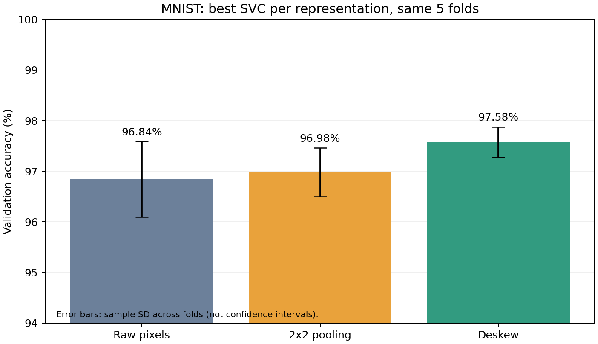
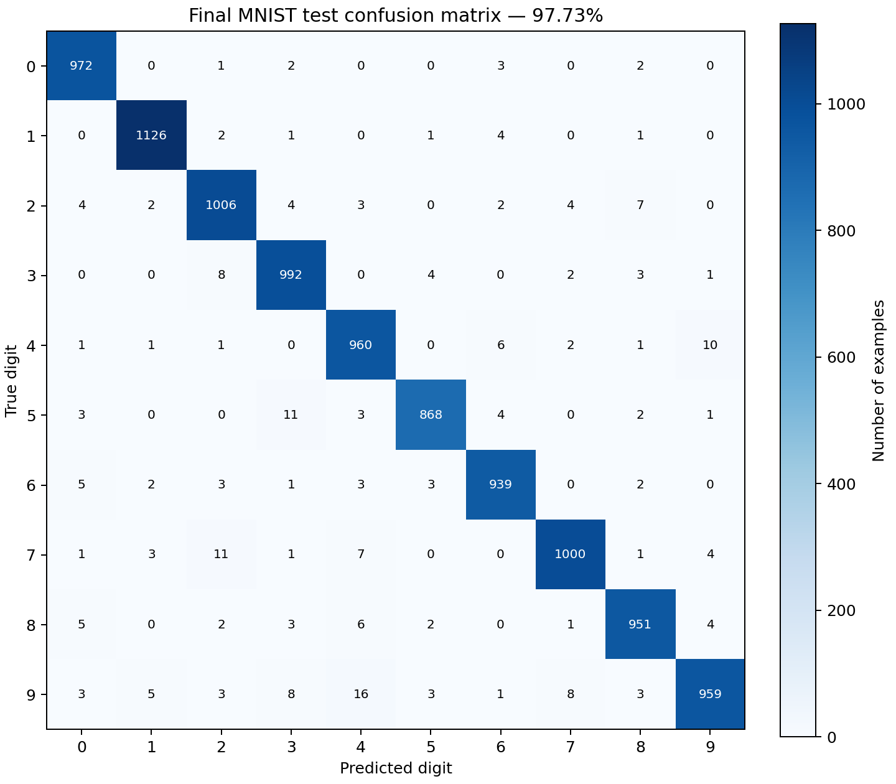

# Thảo luận kết quả MNIST thật

Full run: `run_20261103T120001_917778Z_full_667`. Chương trình hoàn tất trong 187.9 giây sau bước tải dữ liệu.
Dữ liệu: OpenML mnist_784 version=1, 70.000 ảnh; dùng đúng 10.000 ảnh train đầu và 10.000 ảnh test cuối. Không dùng load_digits hay dữ liệu nhân tạo trong run này.

## Lựa chọn mô hình bằng CV

|Family trên raw pixel|Siêu tham số tốt nhất|CV trung bình|
|---|---|---:|
|SVC|`{"C": 10.0, "gamma": "scale", "kernel": "rbf"}`|96.84%|
|KNN|`{"n_neighbors": 3, "weights": "distance", "algorithm": "brute"}`|94.89%|
|ExtraTrees|`{"n_estimators": 200, "min_samples_leaf": 1, "max_features": "sqrt"}`|95.31%|

SVC thắng warmup. Theo yêu cầu đề, phần feature engineering chỉ giữ family SVC và tune lại C = 3, 10, 30 cho mỗi biểu diễn. Trường hợp mean bằng nhau chọn cấu hình xuất hiện trước; không dùng test để phá hòa.

## So sánh biểu diễn trên cùng 5 fold

|Biểu diễn|Chiều|C tốt nhất|Mean CV|Chênh lệch so với raw (điểm phần trăm)|
|---|---:|---:|---:|---:|
|raw|784|10|96.84%|+0.00|
|phi1_pooling|196|30|96.98%|+0.14|
|phi2_deskew|784|30|97.58%|+0.74|

Pooling chia ảnh thành lưới 14×14, lấy trung bình từng ô 2×2. Phép biến đổi giữ phân bố mực theo vị trí và làm mượt nhiễu pixel, giảm chiều từ 784 xuống 196; đổi lại có thể mất nét mảnh. CV tăng nhẹ 0,14 điểm phần trăm, chưa đủ để kết luận cải thiện có ý nghĩa thống kê.

Deskew ước lượng độ nghiêng bằng moment từng ảnh rồi shear theo phương ngang, nội suy bằng NumPy. Nó giảm khác biệt hình học do cách viết nghiêng. CV tăng 0,74 điểm phần trăm so với raw, và điểm của cấu hình deskew thắng cao hơn cấu hình raw thắng trên cả 5 fold. Đây là bằng chứng trên các fold đã chọn, không phải khẳng định mọi tập dữ liệu đều cải thiện.

Các phép biến đổi là hàm xác định của ảnh gốc, không bổ sung thông tin mới. Lợi ích đến từ cách biểu diễn làm thay đổi khoảng cách/inductive bias của mô hình. Deskew vẫn có thể làm mất thông tin do nội suy và cắt biên.

## Mô hình cuối và test

- SVC RBF, `C=30`, `gamma="scale"`, deskew 784 chiều.
- Mean CV: 97.58%.
- Refit trên đủ 10.000 ảnh train, sau đó một lượt predict trên 10.000 ảnh test.
- Test accuracy: **97.73% (9773/10000)**; 227 ảnh sai.
- Vượt ngưỡng 96% của rubric. Không thay đổi siêu tham số hoặc feature sau khi xem test.
- Điểm test cao hơn CV không có nghĩa là leakage: refit dùng 10.000 mẫu, trong khi mỗi fold dùng 8.000 mẫu; thành phần dữ liệu và độ khó cũng khác nhau. Đây là các giải thích có thể, không phải kết luận nhân quả.

## Một số lỗi nhầm nhiều nhất

|Nhãn thật|Dự đoán|Số ảnh|
|---:|---:|---:|
|9|4|16|
|7|2|11|
|5|3|11|
|4|9|10|
|9|7|8|
|9|3|8|
|3|2|8|
|7|4|7|

Các lỗi trên gợi ý những cặp chữ số có nét gần nhau; muốn giải thích nguyên nhân cụ thể cần xem ảnh sai tại `openml_index` trong test_predictions.csv. Không suy ra cơ chế lỗi chỉ từ confusion matrix, và không dùng các lỗi test để tune lại mô hình trong cùng báo cáo.

## Quyết định, tính tái lập và giới hạn

- Năm StratifiedKFold shuffle, seed 202401391; mọi cấu hình dùng lại chính xác các index trong cv_splits.npz.
- Tổng 75 lượt fit CV: 45 warmup + 30 feature engineering. Mỗi fold tạo estimator mới.
- Chuẩn hóa bằng hằng số /255; không fit scaler trên toàn bộ dữ liệu. gamma="scale" chỉ được tính trong fit của từng fold.
- Chốt selection_before_test.json trước khi truy cập test; không tính test riêng cho các baseline/representation khác, tuân thủ yêu cầu test một lần ở phần cuối đề.
- CV được dùng để chọn mô hình nên có thể lạc quan; đây không phải nested CV. SD giữa các fold không phải confidence interval.
- Phiên bản thư viện, seed, checksum train/source, code snapshot, thời gian fit/predict từng fold đều được lưu. Không cần chạy lại test để thảo luận kết quả đã lưu.

